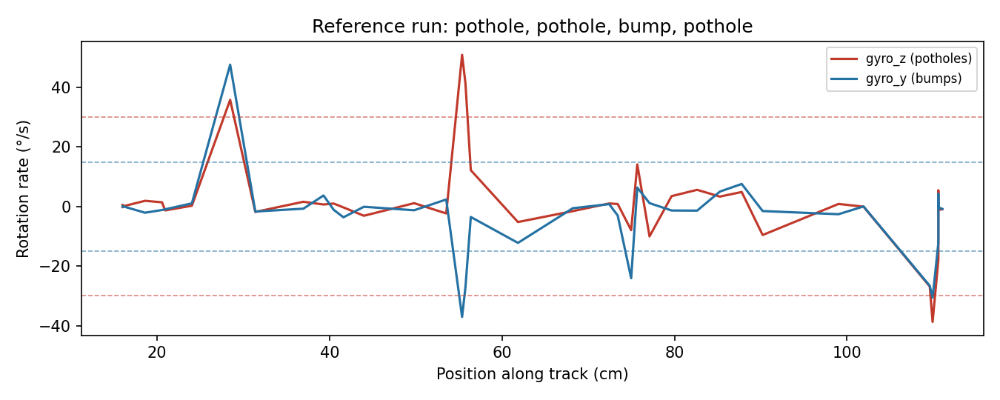

# Road Anomaly Detector (RAD)

An ESP32 survey rig that finds potholes and bumps on a road and records where each one is.

v1 was a team project at PES University, Sep–Nov 2025. v2 is my own follow-up in October 2026, outside coursework and without the original team: I ported the telemetry pipeline to MQTT to get back into IoT.

| Version | Transport | What's in this repo |
| --- | --- | --- |
| v1, Nov 2025 | HTTP POST to Flask | `app.py`, the dashboards, recorded logs, the trained model |
| v2, Oct 2026 | MQTT (topic per device, QoS 1, retained status + Last Will) | `mqtt/` subscriber and replay publisher, tested end to end; `firmware/` ESP32 sketch, untested |

## How it works

1. **The rig.** An RC car carries an ESP32, an MPU-6050-class IMU (accelerometer + gyroscope) and an HC-SR04 ultrasonic sensor. It drives along a 120 cm foam test road with potholes and bumps cut into it.
2. **Sensing.** When a wheel drops into a pothole or rides over a bump, the car pitches and rolls, which shows up as a gyro spike. The HC-SR04 ranges off a fixed wall behind the start line, so its reading is the car's position along the track.
3. **Telemetry.** Each reading (distance, 3-axis acceleration, 3-axis rotation, an on-device spike flag) goes out as JSON over Wi-Fi, about 5 per second. v1 POSTed it to a Flask server; v2 publishes it to `rad/<device>/telemetry` on an MQTT broker.
4. **Logging and live view.** v1: `app.py` appends every reading to `sensor_log.csv` and pushes it to browsers with Socket.IO. v2: `mqtt/subscriber.py` writes the same CSV columns, so the dashboard works unchanged.
5. **Detection.** `rad_dashboard.py` (Streamlit) flags a pothole when |gyro_z| crosses a threshold (default 30 °/s) and a bump when |gyro_y| does (default 15 °/s). It adds a 12 cm sensor-to-front-axle offset to the distance, merges detections within 3 cm, and plots each event on a map of the track.
6. **ML.** `rad_model_20251112_213410.joblib` is a scikit-learn Random Forest (120 trees) trained on four features (acceleration magnitude, rotation magnitude, gyro_z, acc_z) to label readings as Pothole, Hump, Rough or Smooth.

On the reference run (`test_log.csv`), the threshold detector finds the track's layout: pothole, pothole, bump, pothole.

## Results: model vs thresholds



`analysis/compare_model_vs_thresholds.py` runs both detectors on a recorded run. On the reference run (`test_log.csv`) the gyro thresholds find all four features in the right order. The Random Forest labels them only "Rough", never "Pothole" or "Hump", so the final demo used the thresholds. The model's feature importances show why thresholds were enough: gyro_z alone carries 65% of its decision (rotation magnitude 30%, acceleration 6%).

## Files

| File | What it is |
| --- | --- |
| `app.py` | Flask + Socket.IO server: receives readings on `POST /data`, logs to CSV, broadcasts live |
| `rad_dashboard.py` | Streamlit dashboard: threshold detection, distance correction, event map |
| `analysis_dashboard.html` | Standalone Chart.js log viewer |
| `templates/index.html` | Earlier live-dashboard prototype (not wired to `app.py`) |
| `rad_model_*.joblib` | Trained Random Forest classifier |
| `sensor_log.csv`, `sensor_log2.csv`, `test_log.csv` | Recorded runs (acceleration in g, rotation in °/s, distance in cm) |
| `mqtt/subscriber.py` | v2: subscribes to `rad/+/telemetry` and `rad/+/status`, logs readings to CSV |
| `mqtt/replay_publisher.py` | v2: replays a recorded run over MQTT as the ESP32 would, for demos without hardware |
| `analysis/compare_model_vs_thresholds.py` | Runs the Random Forest and the thresholds side by side on a log; `--plot` draws the figure above |
| `firmware/rad_esp32_mqtt/` | v2 ESP32 sketch (MPU-6050 over I2C, HC-SR04, PubSubClient); untested |

## Run it

```bash
pip install -r requirements.txt

# v2 (MQTT): needs a broker, e.g. Mosquitto on localhost:1883
cd mqtt
python subscriber.py --csv ../sensor_log.csv          # terminal 1
python replay_publisher.py ../test_log.csv            # terminal 2: replays a real run
cd .. && streamlit run rad_dashboard.py               # dashboard on the logged CSV

# v1 (HTTP)
python app.py                      # the ESP32 posts to http://<host>:5000/data
```

## Limitations and next steps

- **No transport security yet, in either version.** v1's `/data` takes unauthenticated plain HTTP; v2 uses an anonymous broker on port 1883. Anyone on the network can inject fake readings. Next: per-device credentials, broker ACLs so a device can only publish to its own topic, and TLS on port 8883.
- **v1 made one HTTP request per reading,** which capped sampling at about 5 Hz. v2 keeps one connection open.
- **Server defaults are for development:** placeholder secret key, CORS open to all origins, `debug=True`.
- **Position comes from the reference wall,** so it only works on a track. A real road needs GPS or wheel encoders.
